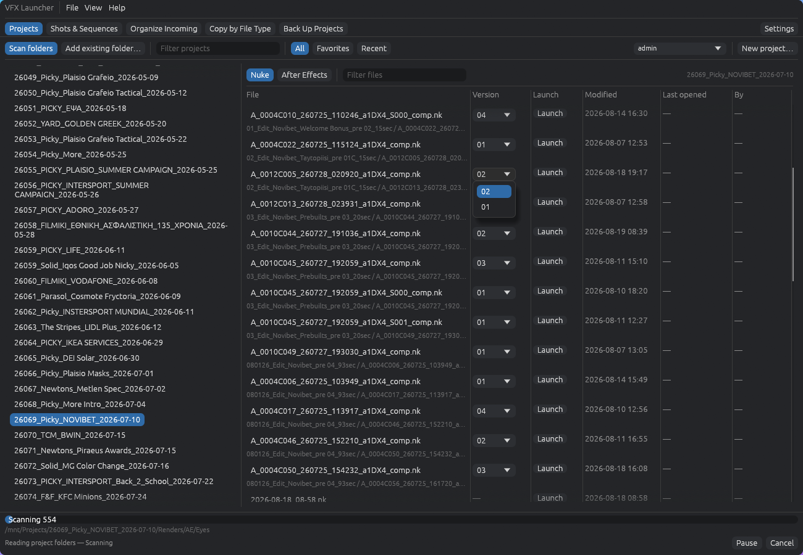
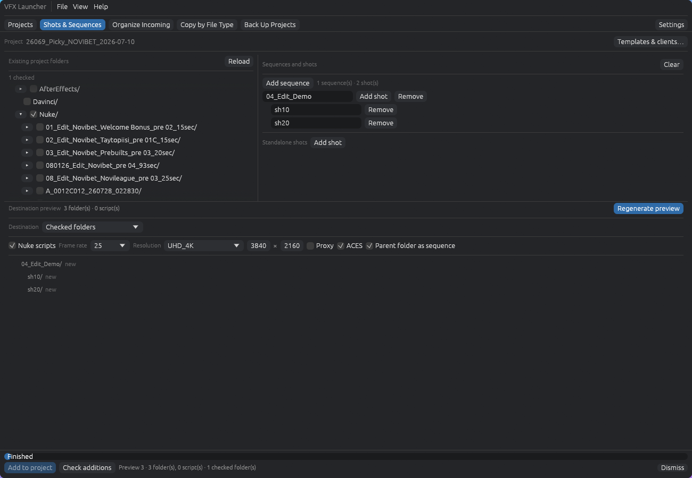
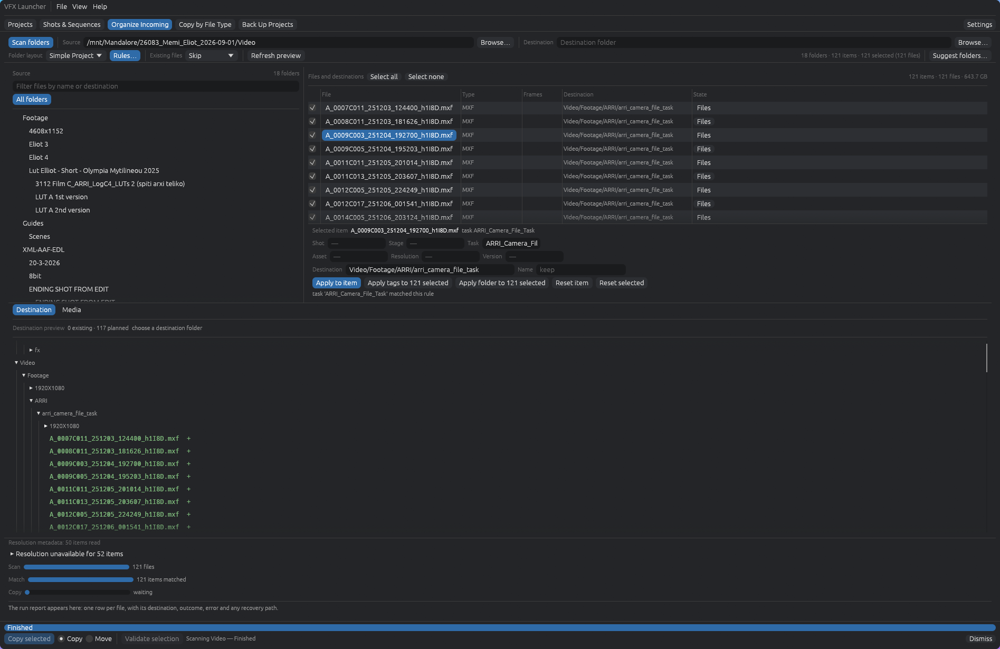
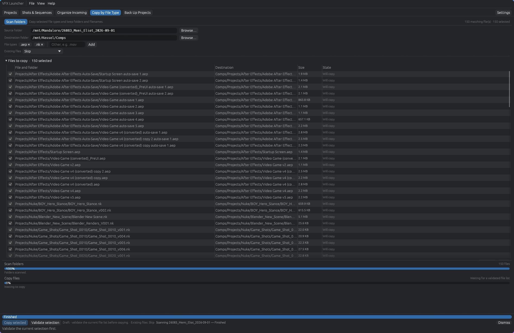
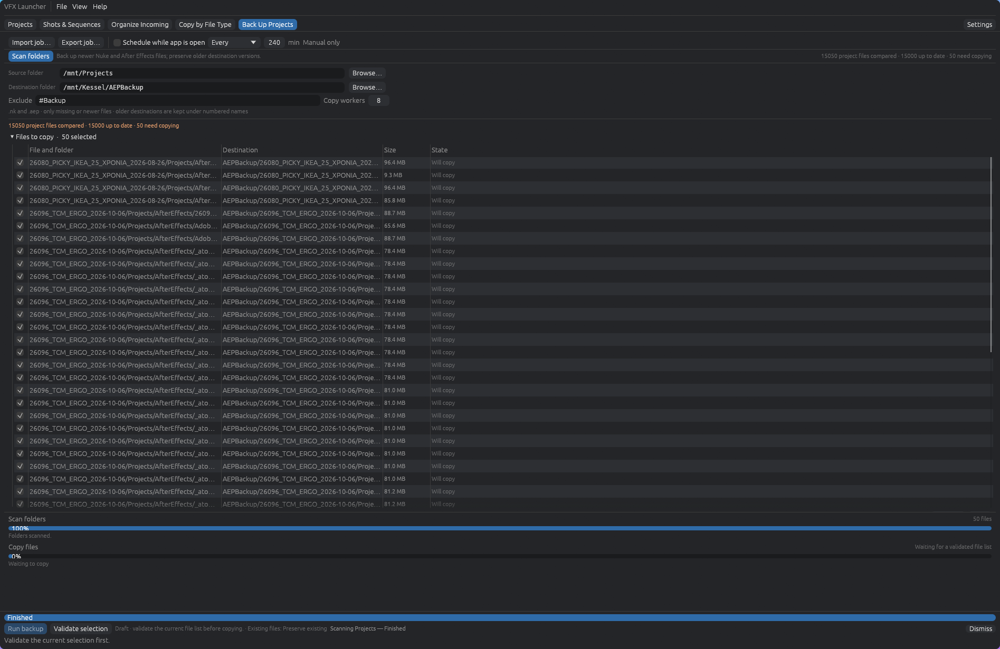

# VFX Launcher

A native Rust/egui desktop for VFX projects: browse and launch Nuke and After Effects files, create shot structures, organize incoming media, copy selected file types, and back up projects with reviewed file-operation plans.

## Downloads

| Platform | Published version | Download | Installation |
| --- | --- | --- | --- |
| Linux x86_64 | **0.3.4** | [AppImage](https://github.com/NickPittas/VFX-Launcher-v2/releases/download/v0.3.4/VFX-Launcher-0.3.4-x86_64.AppImage) · [SHA-256](https://github.com/NickPittas/VFX-Launcher-v2/releases/download/v0.3.4/VFX-Launcher-0.3.4-x86_64.AppImage.sha256) | [Linux guide](docs/LINUX-APPIMAGE.md) |
| Windows 10/11 x64 | **0.2.0 prerelease** | [Portable ZIP](https://github.com/NickPittas/VFX-Launcher-v2/releases/download/v0.2.0/VFX-Launcher-0.2.0-Windows-x86_64.zip) · [SHA-256](https://github.com/NickPittas/VFX-Launcher-v2/releases/download/v0.2.0/VFX-Launcher-0.2.0-Windows-x86_64.zip.sha256) | [Windows guide](docs/WINDOWS.md) |

No Python or Rust installation is needed for these packages. Windows 0.2.0 is already published on GitHub; a Windows 0.3.4 package is not published. The later Linux changes listed below are not included in that Windows download.

## Screenshots

Screenshots supplied by the user of the native desktop pages.

### Projects

### Shots & Sequences

### Organize Incoming

### Copy by File Type

### Back Up Projects

## Latest updates

[0.3.4](docs/RELEASE-0.3.4.md) adds newer ARRI filename recognition, extension-based folder keywords such as `.cube`, resolution metadata during Incoming scans, corrected ffprobe parsing, and Pi model discovery with explicit submission. It also includes the 0.3.3 file-manager reveal and validation-error fixes.

Recent releases improved contained file-link copying, visible execution controls and refusal reasons, stable progress rows, Incoming media previews, external players, and sending media to a running Nuke socket session. See the [release history](CHANGELOG.md) for details and verification limits.

## Get started

1. Download your platform package above and verify its checksum.
2. On Linux, make the AppImage executable and run it. On Windows, extract the ZIP and run `vfx-launcher.exe`.
3. Open **Settings**, configure installed applications, select a user, and save.
4. In **Projects**, use **Add existing folder…** and **Scan folders**, or **New project…** to create a structure.
5. For file operations, scan, review the destination and conflict policy, then **Validate selection** before executing. Check the per-file report afterward.

## User guides

| Page or workflow | Guide |
| --- | --- |
| First run, navigation and safe operation | [Getting started](docs/guides/GETTING-STARTED.md) |
| Projects, versions and launching | [Projects](docs/guides/PROJECTS.md) |
| New projects, templates, shots and sequences | [Shots & Sequences](docs/guides/SHOTS-AND-SEQUENCES.md) |
| Rules, tags, previews, copy/move and Pi suggestions | [Organize Incoming](docs/guides/INCOMING.md) |
| Extension selection and reviewed copying | [Copy by File Type](docs/guides/COPY-BY-FILE-TYPE.md) |
| Backup jobs and schedules | [Back Up Projects](docs/guides/BACKUP.md) |
| Application paths, users and legacy import | [Settings](docs/guides/SETTINGS.md) |
| Logs, failures and recovery information | [History and troubleshooting](docs/guides/HISTORY.md) |

## Requirements and limits

Linux requires x86_64, glibc 2.35+, working desktop OpenGL drivers, and Linux 5.6+ for native transfers. Windows requires Windows 10/11 x64 and working desktop OpenGL drivers. Network locations must already be accessible to the application.

Nuke, After Effects, DJV, MRV2, FFmpeg/ffprobe and the optional external Pi harness are separate host installations where used. Schedules run while the application is open. Full production/NAS, hostile filesystem-race and power-loss behavior are not established by the published checks. Windows directory-entry durability remains unconfirmed; ACLs and alternate data streams are not copied. See platform guides and release notes before moving valuable files.

## Development and documentation

- [Documentation index](docs/README.md), [release history](CHANGELOG.md), and [build instructions](BUILD_INSTRUCTIONS.md).
- Rust desktop and file operations: `rust/`; embedded folder templates: see `rust/src/builtin_templates.rs`.
- [Migration status](docs/migration/IMPLEMENTATION-STATUS.md), [contracts](docs/migration/CONTRACTS.md), and [approved desktop design](docs/migration/DESIGN-APPROVAL.md).
- The [legacy Python application](docs/LEGACY-PYTHON.md) remains available during migration.

Follow [AGENTS.md](AGENTS.md) when contributing. Reference clones in `gitclones/` are read-only inputs and are not shipped.
